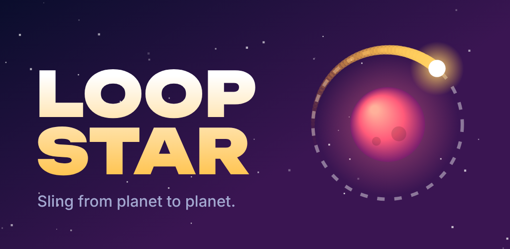

# Loopstar

A one-tap arcade game for phones. Your comet circles a planet; tap to let go and sling into the
next planet's ring. Miss and you burn out. Built as a plain HTML5 canvas game (no engine, no
dependencies) and wrapped for Android with Capacitor.



## How it plays

- **Tap** to release the comet. It flies straight for about 1.3 seconds before it burns out.
- Enter any planet's dashed ring to be caught. Each new planet scores a point.
- Release before one full lap for a **swift streak**: every 3 in a row raises the multiplier, up to x5.
- **Walls bounce.** Landing a bounce shot scores a bonus. Skipping a planet scores for each one skipped.
- A **red tide** rises from below, so you cannot wait forever.
- Later zones add drifting planets, mines and smaller, faster rings.
- Collect **stardust** to unlock comets or to continue a run once. Missions and a daily reward give more.

## Also in this repo: Road to 10K

`tenk/index.html` is a second, separate game: a week-by-week business sim for phones. You quit your job
with $8,000 and a half-built app, plan three things a week (ship, fix, call customers, write, advertise,
sell, freelance, rest), set the price, hire, and handle surprise decisions. You win at $10,000 monthly
recurring revenue and lose if the cash runs out twice. It is one self-contained file: open it in any
browser. `npm run test:tenk` has bots play
1,200 runs to check the balance and taps through the real interface.

## Project layout

| Path | What it is |
| --- | --- |
| `www/` | The whole game: `index.html`, `style.css`, `game.js`, icons, font, PWA manifest and service worker |
| `android/` | Capacitor Android project (package `com.kajmaster.loopstar`, portrait, full screen) |
| `store/` | Play Store material: 512 px icon, feature graphic, 1080x1920 screenshots, listing text |
| `docs/` | Small website served by GitHub Pages: landing page and the privacy policy |
| `tools/` | Local server, automated playtest, asset generator, single-file bundler |
| `.github/workflows/android.yml` | Builds a debug APK and the release bundle on every push (signed once the key is set up) |

## Run it locally

```bash
node tools/serve.js        # then open http://localhost:8080 (use your browser's phone view)
```

Space or a click also launches the comet on desktop.

## Test

```bash
npm test                   # needs Playwright with Chromium
```

A bot plays six runs at accelerated speed. The test fails on any script error, or if the bot cannot get
past 60 planets in at least four runs, which would mean level generation produced an unfair layout.

## Build for Android

Requires Node 22+, JDK 21 and the Android SDK (Android Studio installs it).

```bash
npm ci
npm run android:debug      # android/app/build/outputs/apk/debug/app-debug.apk
npm run android:bundle     # android/app/build/outputs/bundle/release/app-release.aab (unsigned)
```

No Android Studio? Every push runs the **Android build** workflow; download the APK from the run's
artifacts on GitHub and install it on a phone.

## Signed release builds

Google Play only accepts a bundle signed with your own **upload key**. The key stays out of this
repository: you create it once on your computer and store it as two GitHub secrets. From then on every
build produces `loopstar-release-bundle-signed`, ready to upload.

**1. Create the key** (needs Java, which provides `keytool`). Choose a strong password when asked:

```bash
keytool -genkeypair -v -storetype PKCS12 -keystore loopstar-upload.p12 -alias upload \
  -keyalg RSA -keysize 2048 -validity 10000 -dname "CN=Loopstar"
```

The alias must be `upload`. Keep `loopstar-upload.p12` and its password somewhere safe, with a backup,
and never commit them.

**2. Turn the key file into text** so it fits in a secret:

```bash
base64 -w0 loopstar-upload.p12 > key.txt        # Linux
base64 -i loopstar-upload.p12 -o key.txt        # macOS
[Convert]::ToBase64String([IO.File]::ReadAllBytes("loopstar-upload.p12")) > key.txt   # Windows PowerShell
```

**3. Add two secrets** on GitHub under *Settings > Secrets and variables > Actions > New repository secret*:

| Secret name | Value |
| --- | --- |
| `ANDROID_KEYSTORE_BASE64` | the full contents of `key.txt` |
| `ANDROID_KEYSTORE_PASSWORD` | the password you chose |

Delete `key.txt` afterwards.

**4. Run the build** (push a commit, or *Actions > Android build > Run workflow*) and download
`loopstar-release-bundle-signed` from the run.

Until the secrets exist, the build uploads an unsigned bundle and checks the signing setup with a
throwaway key that is discarded. To sign on your own computer instead, set `LOOPSTAR_KEYSTORE_FILE`
(absolute path to the `.p12`) and `LOOPSTAR_KEYSTORE_PASSWORD`, then run `npm run android:bundle`.

## Privacy policy page

`docs/` is a small website for GitHub Pages. To publish it: *Settings > Pages > Build and deployment >
Deploy from a branch*, choose `main` and the `/docs` folder, and save. After a minute or two the policy
is at `https://kajmaster.github.io/Game/privacy.html`. Add your contact email in `docs/privacy.html`
(look for the `CONTACT` comment) before you link it in Play Console.

## Publish to Google Play

1. Create a Play Console developer account (one-time fee, identity verification).
2. Decide the final package name **before the first upload**; it can never change afterwards. It is set in
   `capacitor.config.json` and `android/app/build.gradle` (plus the Java package folder).
3. Set up the upload key as described under *Signed release builds*.
4. Create the app in Play Console and upload the signed `.aab`. Accept Play App Signing when asked. Use the
   text in `store/listing.md` and the graphics in `store/`.
5. Publish the privacy policy page (above) and link it in the listing.
6. Fill in the content rating questionnaire and the data safety form (the game collects no data).
7. New personal developer accounts must run a closed test (currently 12 testers for 14 days) before
   Google allows a production release.
8. For each update, raise `versionCode` and `versionName` in `android/app/build.gradle`.

## Changing things

- Balance lives at the top of `www/game.js` (`FLY_SPEED`, `BURN_TIME`, `REVIVE_COST`) and in `genPlanet()`.
- Comets are the `SKINS` table, missions the `MISSIONS` table.
- After changing art in `tools/make-assets.js`, run `NODE_PATH=$(npm root -g) npm run assets`.
- The game has no ads or purchases. The "Continue" button spends stardust; it is the natural place to
  offer a rewarded ad later.

## Credits

Display typeface: [Unbounded](https://fonts.google.com/specimen/Unbounded), SIL Open Font License 1.1.
